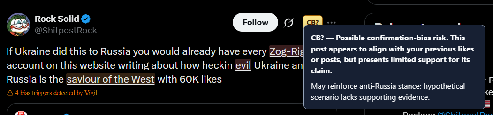

# Activity tracking and confirmation-bias detection


**Track interactions** in the Analyze sidebar is off by default. When enabled,
Vigil records visits to recognized news domains and X exposure metadata in local IndexedDB storage. Text is saved only for liked posts and your own posts; ordinary
seen posts retain account, post ID/link, time and feed context. Previously saved
exposure text is removed in resumable maintenance batches. Collection works with the sidebar closed.
URL query strings and fragments are omitted; incognito activity is excluded.

- Website visits older than one calendar month are removed at startup/update and
  during hourly maintenance while Chrome is running.
- A like saves the post. An unlike removes the saved like and unused preference
  data.
- Repeated longer text snapshots share storage while preserving historical text.
  Existing records are migrated automatically.
- Pausing tracking keeps saved history, subject to visit retention. **Delete
  activity** removes the dataset and pauses tracking. Uninstalling the extension
  also removes its local storage. JSONL export provides a portable copy.

**Influence Dashboard** opens interactive account rankings, a daily activity chart,
news-site statistics, and searchable records. Filters include date, viewing account,
and home-feed context. Repeated exposures count separately; likes reflect saved
likes in the selected period. Unliking removes the like from these statistics.
Dashboard processing runs locally in a worker; no statistics are sent to a backend.

### Confirmation-bias plugin

Enable **Settings → Plugins → Confirmation bias** independently of tracking and
configure an LLM. Existing cognitive-bias detectors continue to work independently.
Disabling CB prevents new requests and discards pending results; requests already
sent may finish.

CB analysis needs at least two distinct relevant liked or self-authored posts from
one known viewing account. Ordinary feed exposures are excluded. A local MiniLM
encoder and keyword matching retrieve up to 12 evidence posts; semantic retrieval
examines the latest 2,000 preference posts. English stopwords are excluded from
keyword matching. Retrieval thresholds are heuristics and need evaluation on
representative histories; topic similarity does not establish viewpoint alignment.

The LLM flags a possible risk only when a claim aligns with the historical viewpoint
and its visible support is absent, incomplete, or weak. Agreement alone is not
sufficient. The model cannot open links or inspect media, and a warning is neither
a fact-check nor a judgment about the reader.

On X, qualifying posts receive an amber **CB?** badge. Hover, focus, or click to
read its explanation. CB findings do not trigger automatic rewrites or hiding.
Personalized results are not stored in the ordinary analysis cache.
The badge uses a closed shadow root, and its personalized explanation is inserted
only while the tooltip is open. This blocks ordinary page scripts from reading
it through `element.shadowRoot`; it is not full isolation from the host page.
The page can still observe the badge's presence and modify or remove its host.



Embeddings run locally from bundled assets. Relevant historical excerpts are sent
to the selected LLM provider, including a cloud provider when configured. Cloud
CB inference can overlap ordinary analysis; local model generation is serialized.

### Diagnostics and validation

- **Analyze → Diagnostics → Storage usage and record counts** shows storage
  estimates, cache bytes, activity counts, and raw embedding size. Installed files
  and RAM are excluded. It does not display browsing URLs or post text.
- **Activity and confirmation bias → CB diagnostics** shows the latest check's
  timings, retrieved context, prompts, response, and validation results. Traces
  live only in sidebar memory. Exported traces contain post text; credentials and
  request headers are excluded.

Run the automated checks with a supported Node version:

```bash
cd frontend
npm test
npm run build
npm run test:embeddings
npm audit
```

Tests cover storage, retrieval, badges, cancellation, and the packaged encoder.
Live X selectors and LLM judgments still require browser testing. Collection uses
observed UI transitions, not server-confirmed interactions; already-liked posts
are not imported. Media handling uses available text/alt text, not OCR or video
transcription. Activity is not synchronized across devices.

### News-site recognition

The news-domain catalog uses [Media Cloud Geographic Collections](https://zenodo.org/records/18189311),
the official January 8, 2026 export, with explicit collection membership. Sources must have a digital, print, radio, or television publisher classification,
or (when the type is missing) a publication name rather than a bare URL/domain label.
Entries with "other" classifications and URL-restricted child sources are excluded. This is
a conservative publisher list, not a complete catalog or a trustworthiness rating.
No hardcoded website allowlist or blacklist is used; X retains its separate collector.

The backend serves a prepared snapshot at `GET /news/sources`. Prepare it before
installing/updating the extension:

```bash
cd backend
.venv/bin/python news_catalog.py
```

The command downloads three public CSV exports, verifies pinned SHA-256 checksums,
and atomically replaces `backend/.cache/news-sources.json`. It does not require
`MEDIACLOUD_API_KEY`. `MEDIACLOUD_CACHE_PATH` optionally selects a persistent
file path. The source edition is pinned and displayed in the dashboard; refreshing
the cache does not make the underlying export newer. A future published edition
requires updating the dataset URL and checksums after review.
The endpoint serves the snapshot without upstream calls; an unprepared server returns 503.

On install/update, the extension makes **one request** to `/news/sources` at its
configured Vigil server URL and caches the domains locally. There are no news-list
requests on navigation, browser startup, or dashboard open, and no polling or
automatic retries. A failed download preserves the last valid curated cache.
On first use (or migration from the old provider), no news visits are saved until
a Media Cloud snapshot is available. After preparing the backend or correcting its
URL, reload the unpacked extension to retry. The dashboard Refresh button only
rereads local data. The previous full-directory cache is never reused. Previously collected visits
that do not match the curated list are removed after a successful download.

Visits are matched locally, including subdomains within public-suffix boundaries.
No browsing URLs or page text are sent to the catalog provider. The public catalog
survives deletion of personal activity. Existing non-news visit records are hidden
from the dashboard and removed in batches after a valid catalog is available;
X records are unaffected. The one-month visit retention policy still applies.

News visits count once per tab while it remains on the same normalized page URL.
Reloads and History API updates that only change the query or fragment do not
add visits. Navigating to another article or leaving and returning counts again;
a separate tab also counts separately. This deduplication survives extension
worker suspension, and tab state is discarded when the tab or browser closes.
Previously saved visit counts are not retroactively deduplicated, since historical
records cannot reliably distinguish reloads from intentional return visits.
